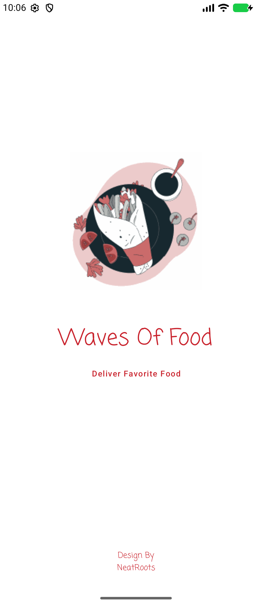
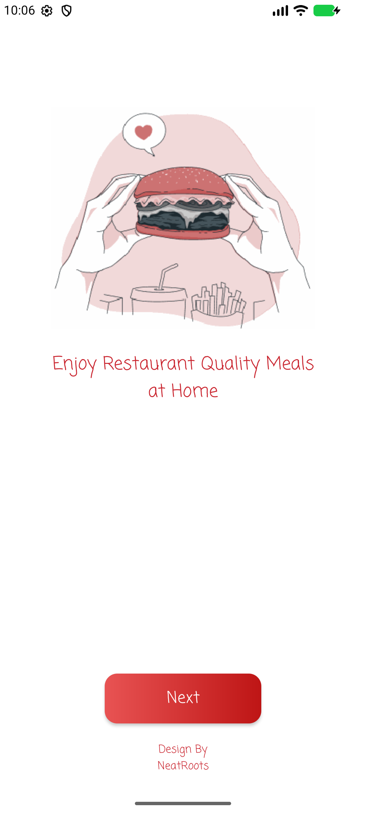
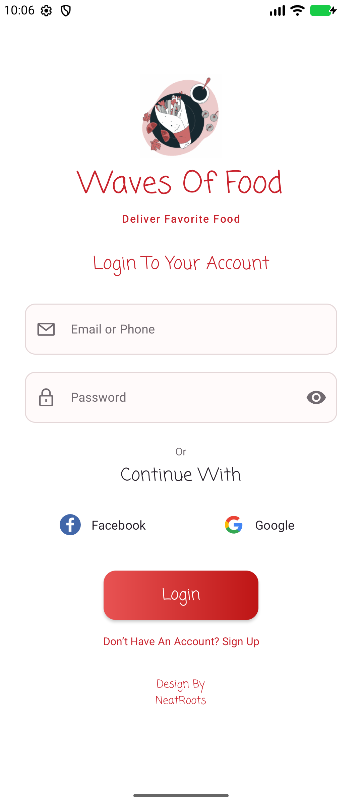
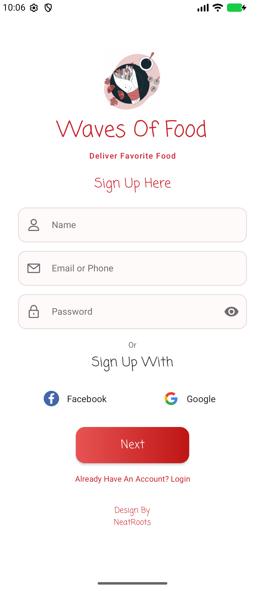
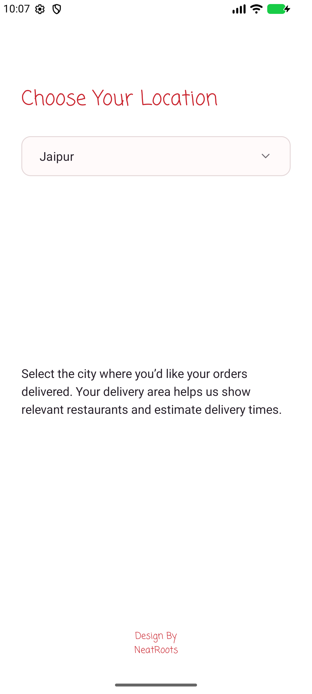

# Waves Of Food

`Kotlin 19. Android UI Components and Layouts.pdf` 19–25쪽을 참고해 Kotlin과 XML로 구현한 Android 과제입니다.

- [과제 시연 영상 MP4](https://github.com/hsw0518/waves-of-food-android/raw/refs/heads/main/downloads/WavesOfFood-assignment.mp4)
- [Android 설치 파일 APK](https://github.com/hsw0518/waves-of-food-android/raw/refs/heads/main/downloads/WavesOfFood-debug.apk)
- [전체 소스 ZIP](https://github.com/hsw0518/waves-of-food-android/archive/refs/heads/main.zip)

## 시연 순서

1. **SplashActivity**가 음식 로고와 앱 이름을 표시한 뒤 약 3초 후 홈으로 이동합니다.
2. **MainActivity**에서 **Next**를 누르면 로그인 화면이 열립니다.
3. **LoginActivity**에서 **Don’t Have An Account? Sign Up**을 누르면 회원가입 화면이 열립니다.
4. **SignUpActivity**에서 이름, 이메일 또는 전화번호, 비밀번호를 입력한 뒤 **Next**를 누릅니다.
5. **LocationActivity**에서 기본 도시 Jaipur를 확인하고 목록에서 다른 도시를 선택할 수 있습니다.

| 스플래시 | 홈 | 로그인 | 회원가입 | 위치 선택 |
| --- | --- | --- | --- | --- |
|  |  |  |  |  |

## Android Studio에서 실행

1. 저장소를 복제하거나 ZIP을 풀고 프로젝트 폴더를 Android Studio에서 엽니다.
2. Gradle Sync가 끝나면 `app` 실행 구성과 Android 기기 또는 에뮬레이터를 선택합니다.
3. **Run**을 눌러 스플래시부터 확인합니다.

최소 Android 버전은 API 24이고, compile/target SDK는 37입니다. Gradle 데몬은 JDK 25를 사용합니다.

회원가입 양식은 화면 전환을 위한 로컬 입력 검사이며, 녹화에는 예시 정보를 사용했습니다. 위치는 목록에서 직접 선택합니다. 실제 계정 인증, 소셜 로그인, 주문, 결제에는 별도의 서버 연동이 필요합니다.

## 검증

```powershell
.\gradlew.bat assembleDebug testDebugUnitTest lintDebug connectedDebugAndroidTest
```

단위 테스트 3개와 에뮬레이터 테스트 7개가 통과했고 Lint 오류는 0개입니다. MP4는 Android 에뮬레이터에서 직접 녹화했습니다.

음식 일러스트는 제공된 PDF의 시안을 참고했습니다. 시안 크레딧은 NeatRoots입니다.
